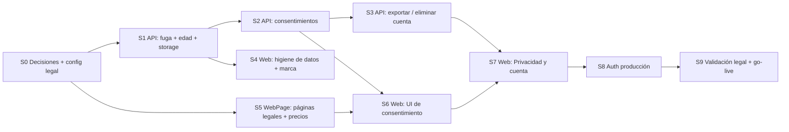

# Plan de cumplimiento legal para producción — Fideliapp

Fuente: `auditoria_legal_produccion.md`. Este plan pasa la auditoría a **10 sesiones secuenciales**. Cada sesión deja los repos en verde (tests + typecheck), se puede commitear por separado y sigue el flujo del orquestador: **API → Web → rutas/guards → docs**, luego `reviewer` → `tester` → `db-auditor` (si hubo SQL) → actualizar `documentacion/ai/`.

> [!IMPORTANT]
> La **Sesión 0** necesita decisiones tuyas. Sin ellas se puede avanzar con marcadores (`TODO_LEGAL`) centralizados en un solo archivo de configuración, pero **no se puede salir a producción** hasta reemplazarlos.

## Estado de avance

> Al terminar cada sesión, el agente actualiza esta tabla (estado, fecha, commits) y anota desvíos o decisiones nuevas.

| Sesión | Estado | Fecha | Notas / commits |
|---|---|---|---|
| S0 | Completada | 2026-11-25 | `legal.config.ts` creado en Web y WebPage, `VITE_LEGAL_SITE_URL` en `.env.example` + Vercel (`Production, Preview`), tests y typecheck en verde. Pendientes `TODO_LEGAL`: confirmar DV del NIT contra RUT y dirección física de notificación. |
| S1 | Completada | 2026-11-25 | Migración `20261126000100_legal_p0_privacy_fixes.sql` (`business_search_profiles` restringido + rate limit, edad 18+ en `profile_update` + trigger/check, políticas `SELECT` en `storage.objects` + `previous_storage_path` en 4 RPCs), `legal-p0-tests.sql`, ajustes Web, `reviewer`, `db-auditor` y `npm test` API (40 migraciones, 13/13 suites, 4/4 concurrencia) en verde. Corregidos 2 typos preexistentes en `sales-qr-regenerate-social-tests.sql`. |
| S2 | Completada | 2026-11-25 | Migración `20261126000200_legal_consents.sql` (enum `legal_document_type`, tabla `user_legal_consents` con RLS solo `SELECT` propio, FKs `ON DELETE RESTRICT` y trigger `user_legal_consents_immutable`, `legal_current_versions()`, `legal_consent_record`, `legal_consent_status`, `legal_consents_my_list`, `legal_consent_revoke` con `p_revoke_all`, compuerta `LEGAL_CONSENT_REQUIRED` en `business_register`), `legal-consents-tests.sql` (104 aserciones), actualización de suites SQL previas + concurrencia en `test-db.sh`, mensajes de error en Web y context packs (`rpc-contract.md`, `schema-summary.md`, `gotchas.md`). `reviewer`, `db-auditor` (0 críticos/altos) y `tester` (41 migraciones, 14/14 suites / 850 aserciones, 4/4 concurrencia, Web typecheck + 12/12 unit) en verde. Nota operativa: no hacer `db:push` en producción antes de desplegar S6 (`OnboardingWizardPage`). |
| S3 | Completada | 2026-11-25 | Migración `20261126000300_account_rights.sql` (`profiles.deleted_at`, tabla inmutable sin PII `account_deletion_log`, `profile_export_my_data()`, `account_delete_my_account(p_confirm)` con confirmación literal `'ELIMINAR'`, bloqueo determinista `ACCOUNT_LAST_ADMIN` coordinado con `business_membership_create`, transferencia de `businesses.created_by`, conservación de ledger inmutable, limpieza de PII en `profiles`/`audit_log`/`business_audit_logs`/`private.bootstrap_admins`/`auth.*`, `banned_until` finito compatible con GoTrue, retorno de `avatar_storage_paths` sin violar `storage.protect_delete()`, triggers anti-TOCTOU `BEFORE INSERT` y guardas `deleted_at is null` / `account_deleted` en RLS y RPCs), `account-rights-tests.sql` (135 aserciones), prueba de concurrencia de 2 admins eliminando cuenta a la vez en `test-db.sh`, mensajes de error en Web (`errors.ts` + `errors.test.ts`) y context packs (`rpc-contract.md`, `schema-summary.md`, `gotchas.md`). Verificado empíricamente en `supabase/postgres:17.11.0.003` (rol `postgres` no superusuario, sin `supabase_auth_admin`) que `SECURITY DEFINER` puede hacer DML en `auth.*`: **no se requiere Edge Function** (S7 llamará directo a la RPC y luego `storage.remove(avatar_storage_paths)` + `signOut`). `reviewer`, `db-auditor` (0 críticos/altos; medios/bajos resueltos), API `npm test` (42 migraciones, 15/15 suites / 990 aserciones, 5/5 concurrencia) y Web (`tsc -b` + 43/43 archivos / 245 unit tests) en verde. |
| S4 | Completada | 2026-11-25 | `image.ts` re-codifica siempre mediante `<canvas>` (elimina EXIF/GPS) + `removeBusinessAssetPath` / `storagePathFromPublicUrl` conectados en `onSuccess` de los 4 hooks de imagen (`profile_avatar_set`, `business_logo_set`, `product_upsert`, `loyalty_reward_upsert`) y limpieza de huérfanos en `catch` (`ProfilePage`, `BusinessProfileForm`, `ProductsPage`). `clearLocalUserData()` purga borradores, `fidelizacion:selected-business*`, `fidelizacion:pending-claim`, `fidelizacion:onboarding:*` y `sessionStorage` en `AuthProvider.signOut` y en cierre remoto/cambio de usuario conservando `fideliapp:theme`. `ProfilePage` valida `birth_date` con `MIN_AGE` (18+) en `America/Bogota` con ajuste bisiesto (`maxAdultBirthDateBogota`), `max`, `autoComplete="bday"` y foco al primer campo inválido. Rebrand total a Fideliapp/monedas: claves `fideliapp:theme` y `fideliapp:draft:*` con migración única en ambos repos, `formatCoins` / `CoinSvg` / `coin*`, eliminación de `public/loopoint-coin.png`, `seed_test_data.sql` (`@fideliapp.test` / `Fideliapp2026!`), renombre `tests/db/loopoint-*.sql` → `fideliapp-*.sql`, migración aditiva `20261126000400_rebrand_fideliapp_comments.sql` (`COMMENT ON` + `'fideliapp'` y variantes en `private.nickname_is_reserved`, conservando la marca anterior para evitar suplantación), docs/`design-system/fideliapp` actualizados y `graphify update .` regenerado. `reviewer` (hallazgos resueltos), `db-auditor` (0 críticos/altos/medios) y `tester` en verde: Web (`tsc -b`, 45/45 archivos / 263 unit, 5/5 E2E perfil y cierre de sesión), WebPage (`tsc -b`, 3/3 archivos / 21 unit) y API (43 migraciones, 15/15 suites / 993 aserciones, 5/5 concurrencia). Nota: la UI de miembros ya había migrado a invitaciones QR (`business_member_invite_create`) y retirado `useSearchProfiles` en S1. |
| S5 | Completada | 2026-11-25 | Creado layout `LegalPage` (versión, fecha de vigencia validada por calendario, índice scrollspy `scroll-target-group` + fallback `IntersectionObserver`, tablas responsivas con container query en `.legal-table-container`, estilos `@media print` y navegación cruzada) y contenido estructurado en `src/features/legal/content/*.ts` para `/privacidad`, `/terminos`, `/terminos-negocios`, `/dpa`, `/cookies` (inventario real post-S4 sin banner intrusivo), `/eliminar-cuenta` (opción inmediata en app + solicitud sin sesión ≤ 15 días hábiles) y `/contacto` (datos del titular, plazos 10/15 días hábiles, SIC y formulario `mailto:` accesible con `:user-invalid` + sincronización ARIA y copiado seguro). Rutas lazy registradas en `App.tsx`, footer de 4 columnas en `SiteLayout.tsx` con columna Legal, datos del titular, aviso de almacenamiento y enlace a la SIC. Ajustes comerciales en `PricingPage.tsx`, `webContent.ts`, `FeaturesPage.tsx` y `HomePage.tsx`: nota tributaria de persona natural no responsable de IVA (`Art. 437 par. 3 ET`), totales anuales (`$588.000` / `$1.308.000 COP / año`), retiro de «para siempre» y promesas vinculantes de roadmap, CTAs con nota de acceso inicial y FAQ sincronizado con `index.html`. SEO/infra: `sitemap.xml`, `llms.txt`, JSON-LD `Organization.contactPoint` + `<noscript>` en `index.html`, `_redirects` verificado sin conflicto y sin `404.html` (fallback SPA HTTP 200 nativo en Cloudflare Pages), y docs (`AGENTS.md`, `README.md`, `documentacion/ai/routes-web.md`). Nota: fuentes Google Fonts se mantuvieron (autoalojamiento `@fontsource` opcional diferido) y se declararon honestamente en `/privacidad`, `/dpa` y `/cookies`. `reviewer` (3 altos, 6 medios y 6 bajos resueltos), `tester` y revisión visual con `browser` en verde (`format`, `tsc -b`, `eslint` 0 errores, 4/4 archivos / 32/32 unit, build sin `dist/404.html` y 4/4 E2E en desktop/móvil). |
| S6 | Completada | 2026-11-25 | Creado módulo `src/features/legal/` (`hooks.ts`, `LegalConsentCheckbox.tsx`, `ConsentGate.tsx`, `AcceptTermsPage.tsx`, `LegalFooterLinks.tsx`), tipos en `src/types/index.ts` y claves en `src/lib/queryKeys.ts`. `LoginPage` exige checkbox sin premarcar en registro por correo, guarda `terms_customer` + `privacy_policy` al crear sesión (evitando carrera de redirección con `submitting`) y muestra enlaces legales en login/footer. `router.tsx` protege portales autenticados con `ConsentGate` (redirige a `/aceptar-terminos` respetando `next` y `pending-claim`). `OnboardingWizardPage` exige checkboxes de Términos B2B + DPA + facultad legal y registra `terms_business` + `dpa` antes de `business_register`. `BusinessJoinPage` y `ClaimPage` actualizados con aviso Art. 14–15 Decreto 1377. `CustomerShell`, `AdminShell`, `EncargadoShell` y onboarding nuevo incluyen `LegalFooterLinks`. `fake-supabase.ts`, `documentacion/ai/routes-web.md`, `LegalConsent.test.tsx` y `legal-consent.spec.ts` actualizados. `reviewer` (hallazgos resueltos) y `tester` en verde (`tsc -b`, 46/46 archivos / 269/269 unit, 43/43 E2E, `test:build` aprobado). |
| S7 | Completada | 2026-11-25 | Migración aditiva `20261126000500_customer_points_expiry_summary.sql` (`customer_points_expiry_summary(p_business_id)` con lógica FIFO idéntica a `points_expire_due`, `ORDER BY` explícito en subconsultas `LIMIT`, guardas `deleted_at is null` / `require_business_role` y `grant execute` solo a `authenticated`), `expiry-summary-tests.sql` en `test-db.sh`, y actualización de `documentacion/ai/rpc-contract.md`. En Web: tipos en `src/types/index.ts`, clave en `src/lib/queryKeys.ts`, hooks `useLegalConsentsMyList`, `useExportMyData`, `useDeleteMyAccount` (con limpieza de `avatar_storage_paths` en Storage + `signOut`) y `useCustomerPointsExpirySummary` (con invalidación de caché tras cambios de programa/canjes), extracción de `todayIsoBogota` a `src/lib/format.ts`, componente `PrivacyAndAccountCard.tsx` integrado en `ProfilePage.tsx` (cliente, admin y encargado) con historial de políticas aceptadas, descarga JSON de `profile_export_my_data` y modal accesible (`Tab` focus trap + retorno de foco) de eliminación literal `'ELIMINAR'` con manejo de `ACCOUNT_LAST_ADMIN`, y bloque de vigencia FIFO + próximos vencimientos (con manejo de error/reintento) en `CustomerBusinessHomePage.tsx`. `fidelizacionWebPage` (`/eliminar-cuenta` en `accountDeletion.ts`) ya enlazaba a `/perfil` y al correo `datos.fideliapp@outlook.com`. `reviewer` (hallazgos resueltos), `db-auditor` (sin vulnerabilidades; recomendación `ORDER BY` aplicada), API `npm test` (incluidas 5 pruebas de concurrencia) y Web (`tsc -b`, 46/46 unit suites tras ajuste en `CustomerBusinessHomePage.test.tsx` y 3/3 E2E en `privacy-account.spec.ts`) en verde. |
| S8 | Completada | 2026-11-25 | `fidelizacionApi/supabase/config.toml` actualizado con `[auth.email]` (`enable_confirmations = true`, `max_frequency = "1m0s"`, `additional_redirect_urls` con `https://fideli-app.vercel.app/**` y puerto E2E `5199`) y plantillas en español en `supabase/templates/` (`confirm.html`, `recovery.html`). En Web: `errors.ts` con mensajes de confirmación/rate-limit/`otp_expired`/`same_password`; `AuthProvider.tsx` con `resendConfirmationEmail`, `resetPasswordForEmail` y `updatePassword`; `LoginPage.tsx` con vista **"Revisa tu correo"** + reenvío, botón de reenvío inline ante `email_not_confirmed`, y flujo **"¿Olvidaste tu contraseña?"** con respuesta neutra; nueva ruta pública `/restablecer-clave` (`ResetPasswordPage.tsx` en `router.tsx`) con lectura de errores en query y hash `#error=...`. E2E `fake-supabase.ts` (`requireEmailConfirmation`, `/resend`, `/recover`, `/token` bloqueando `emailConfirmed === false`) + `auth-production.spec.ts` y unit tests (`LoginPage.test.tsx`, `ResetPasswordPage.test.tsx`). Docs actualizados (`CONFIGURACION.md`, `SEGURIDAD.md`, `ai/routes-web.md`). `reviewer` (hallazgos resueltos) y `tester` en verde (`tsc -b`, 37/37 unit focalizadas, 5/5 E2E focalizadas, `npm run build` aprobado). Nota operativa: falta configurar SMTP propio (SPF/DKIM/DMARC), `site_url`, redirect URLs y copiar plantillas en el panel de Supabase hospedado antes de S9. |
| S9 | En progreso | 2026-11-25 | Verificación integral en verde: API `npm test` (44 migraciones, 5/5 concurrencia), Web (`tsc -b`, `vite build`, 47/47 archivos unit, 48/48 E2E) y WebPage (`tsc -b`, `vite build`, 4/4 archivos / 32/32 unit, 4/4 E2E). Actualizado `documentacion/ESTADO_PROYECTO.md`. Pendiente acción del titular: resolver `TODO_LEGAL` (DV NIT + dirección física), validación legal/DPA/SIC/RNBD, configurar SMTP/Auth/plantillas en Supabase hospedado, Google OAuth, commits en los 4 repos y despliegue final (`db push`, Vercel, Cloudflare Pages). |

## Mapa de sesiones

| Sesión | Repo(s) | Prioridad | Cierra hallazgos de la auditoría |
|---|---|---|---|
| S0 | workspace | P0 | §5.1, Fase 0 |
| S1 | API (+ el hook web mínimo) | P0 | §1 caución 1.1, §1.3 (Storage), §1.4 |
| S2 | API | P0 | §4.1 consentimientos |
| S3 | API | P0 | §1.3 supresión, §4.1 export/eliminar |
| S4 | Web | P0 | §1.3 EXIF, §4.2 signOut, §1.7 marca |
| S5 | WebPage | P0 | §1.2, §1.6, §2 (docs 1,3–8), §4.3 |
| S6 | Web | P0 | §1.1 consentimiento, §4.2 login/OAuth/join/claim/onboarding |
| S7 | Web | P0/P1 | §4.2 ProfilePage, vencimiento FIFO, §2 doc 8 |
| S8 | API config + Web | P0 | §1.5 |
| S9 | Operación | P0 | §5.1, Fase 3 |
| Backlog | — | P1/P2 | §5.2, doc 9–10, CMP |

---

## S0 — Decisiones del titular y configuración legal central (≈ ½ sesión)

**Decisiones tomadas (25-nov-2026):**

| # | Tema | Decisión |
|---|---|---|
| 1 | Titular | **Persona natural** (programador independiente): **Leonardo Cortés Prieto**, C.C. **1.023.906.172**, NIT **1023906172-2** *(DV calculado con el algoritmo DIAN; confirmar contra el RUT)*, domicilio **Bogotá D.C., Colombia** |
| 2 | Contacto | Tel. **318 176 0717** · Soporte: **`soporte.fideli@outlook.com`** · Habeas Data/PQR: **`datos.fideliapp@outlook.com`** · Horario: **lunes a viernes, 8:00 a. m. – 5:00 p. m.** |
| 3 | Marca | **Fideliapp**. "Loopoint" se elimina por completo (ver S4) |
| 4 | Dominios | Sin dominio propio. Sitio: **`https://fideliapp.pages.dev`** · Plataforma: **`https://fideli-app.vercel.app`** |
| 5 | IVA | **Persona natural no responsable de IVA** (Art. 437 par. 3 ET). Precios como **valor final en COP, sin IVA** |
| 6 | Edad mínima | **18 años** para cualquier cuenta |
| 7 | Eliminación | **Soft delete + anonimización irreversible** (ver S3) |

**Justificación de 5 (IVA):** es la opción más conveniente mientras cumplas **todos** estos requisitos: ingresos brutos de la actividad gravada y consignaciones por debajo de **3.500 UVT** (≈ $183.309.000 en 2026), un solo establecimiento, no estar en el Régimen SIMPLE y no ser usuario aduanero. En el RUT no debe aparecer la responsabilidad 48. Texto para precios: *"Precio final en pesos colombianos. No se cobra IVA: el prestador es persona natural no responsable de IVA."* Si superas el tope, pasas a ser responsable desde ese momento y hay que actualizar precios y RUT. Pide a un contador que confirme el RUT y la obligación de facturar.

**Justificación de 6 (18+):** el contenido no es dañino, pero en Colombia el tratamiento de datos de menores está **prohibido por regla general** (Art. 7 Ley 1581 y Art. 12 Decreto 1377). Solo se permite con autorización del representante legal, escuchando al menor y respetando su interés superior. La SIC ha exigido a plataformas mecanismos **verificables** de esa autorización. Fideliapp recoge historial de compras, perfila frecuencia, pide fecha de nacimiento y planea mensajes de cumpleaños y WhatsApp. Eso es perfilamiento comercial, difícil de justificar para menores. Además, un menor tiene capacidad contractual limitada para aceptar los Términos. Verificar el consentimiento de los padres costaría mucho y aportaría poco. Por eso: Términos "solo mayores de 18", declaración de mayoría de edad al registrarse, rechazo de `birth_date` de menores y procedimiento para borrar cuentas de menores detectadas. Los comercios pueden seguir vendiendo a menores; solo que estos no se inscriben al programa.

**Justificación de 7 (soft delete correcto):** un soft delete **solo con bandera** (`deleted_at` conservando nombre, correo y teléfono) **no cumple** el derecho de supresión. Lo correcto según el criterio de la SIC es:
- conservar la fila y su UUID, para que el ledger, las compras y los canjes de los comercios sigan íntegros;
- **sobrescribir de forma irreversible** todos los datos identificativos;
- bloquear el acceso y borrar archivos e identidades de login.

Así lo que queda son datos transaccionales **no atribuibles a una persona** (montos, fechas, productos), que se pueden conservar. La supresión no procede solo si existe un deber legal de conservar (Art. 2.2.2.25.2.6 del Decreto 1074 de 2015). Las compras en Fideliapp **no son facturas**, porque la factura legal la emite el comercio en su POS. Por eso no hay razón para guardar el nombre del cliente. Se conservan sin PII: la prueba del consentimiento (versión y fecha) y un registro de la supresión. La ley da hasta 15 días hábiles; se recomienda ejecutarla **de inmediato** tras confirmación explícita, sin periodo de gracia (más simple y sin estados intermedios).

**Pendiente de ti:** confirmar el DV del NIT contra tu RUT y definir una **dirección física de notificación**.

> [!IMPORTANT]
> La ley sí exige una dirección: el Art. 13 del Decreto 1377 pide en la Política "nombre, domicilio, dirección, correo y teléfono del Responsable", y el Art. 50 lit. a de la Ley 1480 pide "dirección de notificación judicial" en comercio electrónico. Puede ser la que figura en tu RUT. Si prefieres no publicar tu casa, usa una oficina virtual o un apartado. Mientras tanto queda como `TODO_LEGAL` y bloquea la salida a producción, no el desarrollo.

**Código:**
- Crear `legal.config.ts` en `fidelizacionWebPage/src/config/` y en `fidelizacionWeb/src/config/` (mismo contenido): datos del titular, correos, URLs legales, `LEGAL_VERSIONS = { terms_customer, terms_business, privacy_policy, dpa, cookies }` (formato `YYYY-MM-DD`), `MIN_AGE`.
- Web: variable `VITE_LEGAL_SITE_URL` (base de las páginas legales del sitio comercial) en `.env.example` + Vercel.

**Hecho cuando:** existen ambos archivos con `TODO_LEGAL` donde falten datos; typecheck en verde.

---

## S1 — API: bloqueantes de seguridad y privacidad (P0)

Nueva migración `2026112600xxxx_legal_p0_privacy_fixes.sql`:
1. **`business_search_profiles`** (fuga multiempresa): reemplazar por una versión que devuelva solo
   - perfiles que ya tienen membresía en `p_business_id`, **o**
   - coincidencia **exacta** de correo (`lower(email) = lower(p_query)`) devolviendo como máximo 1 fila, sin `avatar_url` ni datos extra.
   - Revisar el llamado en `fidelizacionWeb/src/features/loyalty/hooks.ts:324` y el texto de la UI ("busca por correo exacto"), o retirarlo a favor de `business_member_invites` (QR) si ya cubre el caso.
2. **Edad mínima 18** en `profile_update` (`20261113000100_profile_phone_birthdate.sql`): `birth_date <= current_date - interval '18 years'` y `>= '1900-01-01'`; error con código claro. También `check` en la tabla (`not valid` + `validate` si no hay datos que lo rompan).
3. **Archivos huérfanos**: en `profile_avatar_set` (y set de logo/imagen de producto/recompensa si siguen el mismo patrón) borrar el objeto anterior de `storage.objects` (bucket `business-assets`) cuando cambie o se quite. Si no se puede desde SQL, devolver la ruta anterior y borrarla desde el cliente con `storage.remove` (lo hace S4).

**Tests:** nuevo `fidelizacionApi/tests/db/legal-p0-tests.sql` (registrar en `run-tests.sql`): un admin de B no ve perfiles no afiliados; correo exacto sí; fecha de nacimiento de menor rechazada; avatar anterior eliminado.
**Cierre:** `cd fidelizacionApi && npm test`, `npm run gen:types`, `db-auditor`, actualizar `rpc-contract.md` + `gotchas.md`.

---

## S2 — API: registro auditable de consentimientos (P0)

Migración `..._legal_consents.sql`:
- Enum `legal_document_type`: `terms_customer`, `terms_business`, `privacy_policy`, `dpa`, `marketing_whatsapp`, `marketing_email`, `marketing_push`.
- Tabla `public.user_legal_consents` (`id`, `user_id`, `business_id` nullable, `document_type`, `document_version`, `accepted_at default now()`, `revoked_at`, `source_route`, `user_agent` opcional). RLS: el usuario solo `select` lo suyo; **sin** insert/update directos (solo vía RPC). Índice `(user_id, document_type, document_version)`.
- Función `legal_current_versions()` (IMMUTABLE/STABLE) con las versiones vigentes, igual a `LEGAL_VERSIONS` de S0.
- RPCs `SECURITY DEFINER`, `search_path` fijo, `grant execute` solo a `authenticated`:
  - `legal_consent_record(p_documents legal_document_type[], p_business_id uuid default null, p_source_route text)` → guarda la versión vigente (el cliente no la envía, así no se puede falsificar).
  - `legal_consent_status()` → documentos obligatorios pendientes para el usuario (clientes: términos + privacidad; admin con negocio: además `terms_business` + `dpa`).
  - `legal_consents_my_list()`, `legal_consent_revoke(p_document_type)` (solo para marketing; revocar privacidad/términos ⇒ indicar que se use la eliminación de cuenta).
- `business_create` / onboarding: exigir que exista consentimiento vigente de `terms_business` + `dpa` (error `LEGAL_CONSENT_REQUIRED`).

**Tests:** `legal-consents-tests.sql` (registro, versión forzada desde el servidor, aislamiento RLS, onboarding bloqueado sin DPA).
**Cierre:** igual que S1 + `schema-summary.md`.

---

## S3 — API: derechos del titular — exportar y eliminar cuenta (P0)

> [!WARNING]
> Las FK `ON DELETE RESTRICT` y el trigger `prevent_ledger_mutation()` impiden el borrado duro. La estrategia recomendada es **anonimizar sin tocar el ledger**: los comercios conservan la integridad contable y la persona deja de ser identificable.

Migración `..._account_rights.sql`:
- `profile_export_my_data()` → `jsonb` con perfil, consentimientos, membresías, compras + items, canjes y movimientos de puntos del usuario autenticado.
- `account_delete_my_account(p_confirm text)` (confirmación literal, p. ej. `ELIMINAR`):
  1. Bloquear si es `last_admin` de un negocio activo (`ACCOUNT_LAST_ADMIN`).
  2. Soft delete + anonimización de `profiles`: `full_name='Usuario eliminado'`, `email='deleted+<uuid>@anonymized.invalid'`, `nickname/phone/birth_date/avatar_url = null`, `deleted_at = now()` (columna nueva). Revisar también los campos de texto libre que contengan PII del usuario (`actor_email` en auditoría ⇒ reemplazar por el correo anonimizado).
  3. Borrar membresías de cliente/encargado, invitaciones y tokens pendientes; borrar `storage.objects` con prefijo `avatars/<uid>/`.
  4. Tabla `account_deletion_log` (`user_id`, `deleted_at`, sin PII) como prueba de la supresión.
  5. `auth`: anonimizar el email de `auth.users`, limpiar `raw_user_meta_data`, `banned_until = 'infinity'` y borrar `auth.identities`, `auth.sessions`, `auth.refresh_tokens`.
- Guards: las RPC que leen perfiles deben ignorar `deleted_at is not null` donde aplique.

> [!CAUTION]
> Verificar al inicio de la sesión que en Supabase hospedado la función (dueño `postgres`) puede hacer DML sobre `auth.*`. Si no puede: habilitar `edge_runtime` y crear la Edge Function `delete-account` (con `service_role`) que llame a la RPC de anonimización y luego `auth.admin.updateUserById` (ban + email). Esto cambia S7 (llamar a la función en vez de la RPC).

**Tests:** `account-rights-tests.sql` (export solo con datos propios; eliminar anonimiza y conserva ledger; last_admin bloqueado; el usuario eliminado no puede volver a entrar).
**Cierre:** `db-auditor` obligatorio, actualizar contratos.

---

## S4 — Web: higiene de datos en el cliente + marca (P0)

- `src/lib/image.ts`: **re-codificar siempre** con canvas (quitar el atajo de ≤ 2 MB / ≤ 1200 px) ⇒ elimina EXIF/GPS. Unit test que confirme que el resultado sale del canvas.
- `AuthProvider.signOut`: purgar `loopoint:draft:*`, `fidelizacion:selected-business:*`, `fidelizacion:pending-claim` y las claves de `sessionStorage` (helper `clearLocalUserData()` + test).
- `ProfilePage`: al quitar o cambiar avatar, usar el borrado de S1 (o `storage.remove` de la ruta anterior); `birth_date` con `max = hoy - MIN_AGE` y mensaje.
- Búsqueda de equipo: adaptar la UI al nuevo comportamiento de `business_search_profiles`.
- **Eliminación total de "Loopoint"** (≈ 45 archivos):
  - Claves de navegador `loopoint:theme` / `loopoint:draft:*` ⇒ `fideliapp:*`, con **migración de una sola vez** que lee la clave vieja y la borra (`theme-init.js` en ambos repos, `useFormDraft.ts`).
  - Identificadores: `formatLoopoints` ⇒ `formatCoins`, `LoopointCoinSvg` ⇒ `CoinSvg`, `loopointWord/Singular/Plural/Label` ⇒ `coin*`. Textos visibles "Loopoints" ⇒ "monedas" (o el nombre que configure cada negocio).
  - Seeds y tests: correos `@loopoint.com` ⇒ `@fideliapp.test`, contraseña `Loopoint2026!` ⇒ `Fideliapp2026!`; renombrar `tests/db/loopoint-*.sql` ⇒ `fideliapp-*.sql` (actualizar `run-tests.sql`).
  - Docs: `AGENTS.md`, `documentacion/**`, `.agents/**`. Regenerar graphify.
  - **Excepción:** los archivos de migración ya aplicados (p. ej. `20261025001000_loopoint_identity_business_profile.sql`) **no se renombran ni se editan**, porque el historial de migraciones es inmutable. Una migración nueva actualiza los `COMMENT ON` que dicen "loopoints". La palabra se mantiene en la lista de slugs reservados para evitar suplantación.
  - Comprobar al final con `grep -ri loopoint` (excluyendo migraciones históricas) ⇒ 0 resultados.

**Cierre:** `npm run typecheck && npm test`; E2E focalizado del perfil.

---

## S5 — Sitio comercial: páginas legales, footer y precios (P0)

- Componente `LegalPage` (layout de texto, índice, "Versión y fecha de vigencia") + contenido en `src/features/legal/content/*.ts` (o `.md`) para revisarlo fácil con el abogado.
- Rutas en `App.tsx`: `/privacidad`, `/terminos`, `/terminos-negocios`, `/dpa`, `/cookies`, `/eliminar-cuenta`, `/contacto` (PQR: correos, plazos de 10/15 días hábiles, formulario `mailto:`).
- Borradores de texto basados en §2 de la auditoría: roles Responsable/Encargado, inventario real de datos, transferencia internacional (Supabase, Vercel, Cloudflare, Google), naturaleza de las monedas, deslinde frente a los comercios, inventario de almacenamiento de §3.1 para la política de cookies (aviso informativo, **sin** banner por ahora).
- `SiteLayout.tsx` footer: columna "Legal", datos del titular, PQR y enlace a la **SIC**.
- `PricingPage.tsx` / `webContent.ts`: nota "Precio final en COP. No se cobra IVA: prestador persona natural no responsable de IVA", total anual con pago anual, "para siempre" ⇒ "sin costo fijo para 1 local (sujeto a Términos)", aviso de roadmap en "Próximamente" y texto en los CTA de planes de pago ("acceso inicial / plan gratuito").
- SEO: `sitemap.xml`, `llms.txt`, JSON-LD `Organization.contactPoint` en `index.html`; confirmar que Cloudflare Pages resuelve rutas SPA directas (`_redirects`) — necesario para que Google OAuth valide las URLs.
- Opcional: autoalojar fuentes (`@fontsource`) en ambos repos.

**Cierre:** build + typecheck de WebPage; revisar visualmente con el subagente browser.

---

## S6 — Web: UI de consentimiento expreso (P0)

- Componente `LegalConsentCheckbox` (sin premarcar, enlaces a `VITE_LEGAL_SITE_URL/...`) y hook `useLegalConsent` (RPC de S2).
- **LoginPage** (registro por correo): checkbox obligatorio "Acepto Términos y Política de Tratamiento de Datos, incluida la transferencia internacional"; guardar el consentimiento al crear la sesión. En login (no registro) solo enlaces.
- **Google OAuth / usuarios existentes**: guard `ConsentGate` en `router.tsx` que consulta `legal_consent_status()` y, si falta algo o cambió la versión, muestra la pantalla `/aceptar-terminos` antes de entrar a cualquier portal (respetar `pending-claim`).
- **BusinessJoinPage** y **ClaimPage**: reemplazar los textos inexactos por un aviso corto (Arts. 14–15 Decreto 1377): qué datos ve *ese* negocio, finalidad, vencimiento de monedas si aplica y enlaces. Quitar "No compartimos datos con otros negocios" salvo que S1 lo haga cierto (sí lo hará).
- **OnboardingWizardPage**: checkboxes de Términos B2B + DPA + declaración de facultad para representar al comercio ⇒ `legal_consent_record` antes de `business_create`.
- Enlaces legales permanentes en `CustomerShell`, `AdminShell`, `EncargadoShell` y footer de Login.

**Cierre:** unit + E2E (registro con y sin checkbox, OAuth nuevo ⇒ gate, onboarding sin DPA bloqueado); actualizar `routes-web.md`.

---

## S7 — Web: "Privacidad y cuenta" + transparencia de vencimientos (P0/P1)

- Sección en `ProfilePage` (cliente y admin): políticas aceptadas (versión y fecha), **Descargar mis datos** (JSON de `profile_export_my_data`), **Eliminar mi cuenta** (modal con confirmación escrita, aviso de pérdida de monedas, manejo de `ACCOUNT_LAST_ADMIN`, cierre de sesión + purga local al terminar).
- `CustomerBusinessHomePage`: regla de vencimiento FIFO del negocio y próximos vencimientos (si ya existe RPC; si no, agregar lectura mínima en API).
- Página `/eliminar-cuenta` del sitio (S5): enlazar al botón de la app y al correo para quien no puede entrar.

**Cierre:** E2E de exportar y eliminar (usuario seed desechable); `reviewer`.

---

## S8 — Autenticación de producción (P0)

- Supabase (panel + `config.toml`): `enable_confirmations = true`, SMTP propio con SPF/DKIM/DMARC, plantillas en español, `site_url` y redirect URLs de producción.
- Web: pantalla "Revisa tu correo" tras registrarse, reenvío de confirmación, flujo **¿Olvidaste tu contraseña?** (`resetPasswordForEmail` + ruta `/restablecer-clave` con `updateUser`).
- Ajustar los E2E/seed que dependían de `autoconfirm` (usar Inbucket local en `54324`).
- Actualizar `SEGURIDAD.md` y `CONFIGURACION.md`.

---

## S9 — Validación legal y salida a producción (operación, sin código salvo ajustes)

Checklist:
- [ ] Revisión de los textos por un abogado colombiano ⇒ subir `LEGAL_VERSIONS` si cambian (el `ConsentGate` volverá a pedir aceptación).
- [ ] Formalización (RUT/Cámara o S.A.S.), correos corporativos activos y procedimiento interno de PQR (10/15 días hábiles).
- [ ] Aceptar los DPA de Supabase, Vercel y Cloudflare; guardar evidencia en `documentacion/privado/`.
- [ ] Google Cloud: Homepage, Privacy y Terms con las URLs de `*.pages.dev`; verificación de la pantalla de consentimiento. **Riesgo:** `pages.dev` y `vercel.app` son dominios compartidos y Google puede pedir verificar la propiedad del subdominio en Search Console; además, sin dominio propio la pantalla de Google mostrará el dominio de Supabase. Si Google lo rechaza, comprar un dominio propio sería la solución.
- [ ] Búsqueda de marca en la SIC (clases Niza 9, 35, 42).
- [ ] RNBD: confirmar si aplica el umbral de 100.000 UVT (probablemente no).
- [ ] Quitar *Deployment Protection* de Vercel; `db:push` de las migraciones; humo en producción.
- [ ] Actualizar `ESTADO_PROYECTO.md`.

---

## Backlog P1/P2 (activar antes de cada función del roadmap)

| Disparador | Requisito |
|---|---|
| Se agrega analítica o píxeles | CMP real (Aceptar/Rechazar/Configurar) que bloquee scripts + actualizar cookies |
| Cobros (`TAREA-1`) | Pasarela PCI, factura electrónica DIAN, página `/pagos-y-reembolsos` (retracto + reversión) |
| Difusiones (`TAREA-3`) | Consentimiento por canal (`marketing_*` de S2), opt-out en un clic, horarios Ley 2300, políticas de Meta |
| Juegos (Suite) | Solo mecánicas de destreza; sin azar o con permiso de Coljuegos |
| Comandera | Etiqueta "Comanda — no válido como factura" hasta tener DIAN POS |
| Chatbot IA (`TAREA-4`) | Aviso de IA, proveedor LLM como subencargado, minimizar PII |
| App Android | Data Safety, URL de privacidad y de eliminación, justificar `CAMERA` |
| UGC | Política de uso aceptable + mecanismo de reporte/retiro (doc 9) |

## Cómo arrancar cada sesión

Pídeme: *"Ejecuta la sesión SN del plan de cumplimiento legal"*. En cada sesión leeré solo los archivos que nombra, implementaré, pasaré `reviewer` / `tester` / `db-auditor` y marcaré la sesión como hecha en este documento.
